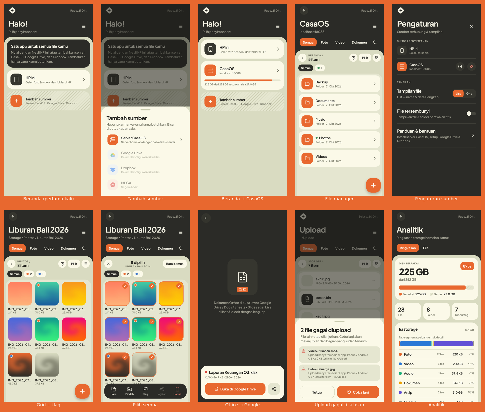

# Casa Files

File manager mobile (iPhone & Android) untuk upload, melihat, dan mengelola foto/video/file di storage homelab CasaOS.



```
┌──────────────┐   HTTP/HTTPS (LAN / Tailscale)   ┌──────────── CasaOS ────────────┐
│  App Expo    │ ───────────────────────────────▶ │ casa-files-server (Docker, Go) │
│ iOS/Android  │   REST + token                   │   /data  ⇢  disk 1.5TB         │
└──────────────┘                                  └────────────────────────────────┘
```

### Cara kerja koneksi

App **tidak** login ke dashboard CasaOS. CasaOS tidak menyediakan API resmi untuk aplikasi pihak ketiga,
jadi repo ini menyertakan server kecil sendiri (`casa-files-server`) yang dipasang di mesin CasaOS dan
membaca/menulis folder yang sama dengan menu **Files** di CasaOS. File yang di-upload lewat app akan
langsung terlihat juga di CasaOS Files (dan sebaliknya), selama `STORAGE_PATH` menunjuk ke folder itu.

| | Dashboard CasaOS | Server Casa Files (untuk app) |
|---|---|---|
| Alamat | `http://<ip-server>` (port 80) | `<ip-server>:8088` |
| Password | Akun CasaOS | Password yang dibuat saat menjalankan `install.sh` |

| Folder | Isi | Dijalankan di |
|---|---|---|
| `server/` | API Go (stdlib, tanpa dependency) + Dockerfile | Server CasaOS |
| `app/` | Aplikasi Expo SDK 58 (React Native + TypeScript) | Laptop (development/build), lalu di-install ke HP |

## Fitur

- Browse folder (list / grid), info kapasitas disk, pull-to-refresh
- Upload multi foto & video dari galeri (file asli HEIC/HEVC), kamera, atau file apa pun
- Antrian upload (2 paralel), progress, cancel, tetap jalan saat app di-minimize
- Upload di-stream ke disk → video ukuran GB aman; nama bentrok otomatis jadi `foto (1).jpg`
- Preview gambar & streaming video (HTTP Range), share / simpan ke Photos
- Folder baru, rename, hapus
- Login password → token HMAC (default 30 hari), proteksi path traversal & symlink escape
- Mode terang/gelap otomatis

---

## 1. Jalankan server di CasaOS

Ada dua cara. **Opsi A** paling ringan dan paling mudah, cocok untuk perangkat kecil
(Jetson Nano, Raspberry Pi) atau server dengan Docker versi lama.

### Opsi A — Tanpa Docker (disarankan untuk Jetson Nano / Raspberry Pi)

Server berupa satu file program (~6MB, RAM ~10MB) yang dijalankan sebagai service systemd.
Mendukung arm64 (Jetson Nano, RPi 64-bit), amd64, dan armv7.

```bash
curl -fsSL https://raw.githubusercontent.com/avenlabs/file-manager-homelab/main/server/install.sh | sudo bash
```

Installer akan menanyakan password dan folder storage, lalu menampilkan alamat untuk diisi di app.
Service otomatis jalan saat boot dan menunggu disk eksternal ter-mount.

| Keperluan | Perintah |
|---|---|
| Status | `sudo systemctl status casa-files` |
| Log | `sudo journalctl -u casa-files -f` |
| Restart | `sudo systemctl restart casa-files` |
| Ubah password / storage | `sudo nano /etc/casa-files/casa-files.env` lalu restart |
| Update ke versi terbaru | jalankan ulang perintah install (konfigurasi tetap) |
| Uninstall | `sudo systemctl disable --now casa-files && sudo rm /etc/systemd/system/casa-files.service /usr/local/bin/casa-files-server` |

Tanpa akses internet di server? Download `casa-files-server-linux-arm64` dan `install.sh` dari
[halaman Releases](https://github.com/avenlabs/file-manager-homelab/releases), copy ke server, lalu
`sudo bash install.sh ./casa-files-server-linux-arm64`.

### Opsi B — Docker Compose

Butuh Docker Compose v2 (`docker compose version`). Kalau belum ada, install plugin-nya:

```bash
sudo mkdir -p /usr/local/lib/docker/cli-plugins
sudo curl -fL https://github.com/docker/compose/releases/download/v2.29.7/docker-compose-linux-$(uname -m) \
  -o /usr/local/lib/docker/cli-plugins/docker-compose
sudo chmod +x /usr/local/lib/docker/cli-plugins/docker-compose
docker compose version
```

Lalu:

```bash
# 1. Clone repo di server
git clone https://github.com/avenlabs/file-manager-homelab.git
cd file-manager-homelab/server

# 2. Buat konfigurasi
cp .env.example .env
openssl rand -hex 32          # salin hasilnya ke TOKEN_SECRET
nano .env                     # isi APP_PASSWORD, TOKEN_SECRET, STORAGE_PATH

# 3. Build & jalankan
docker compose up -d --build

# 4. Cek
curl http://localhost:8088/api/health      # → {"status":"ok"}
docker compose logs -f                     # lihat log (Ctrl+C untuk keluar)
```

**`STORAGE_PATH`** adalah folder di server yang akan bisa diakses app. Cek lokasi disk 1.5TB kamu
di dashboard CasaOS → Storage (biasanya `/DATA/...` atau `/media/<nama-disk>`). Folder lain di luar itu
tidak bisa disentuh app.

Container otomatis jalan lagi setelah server reboot (`restart: unless-stopped`) dan muncul di dashboard CasaOS.

**Update ke versi terbaru:**

```bash
cd file-manager-homelab && git pull
cd server && docker compose up -d --build
```

### Akses dari luar rumah (disarankan: Tailscale)

Jangan buka port 8088 langsung ke internet. Pilihan:

- **Tailscale** (ada di App Store CasaOS): install di CasaOS + di HP, lalu di app isi alamat `<ip-tailscale>:8088`.
  Untuk HTTPS: `tailscale serve --bg 8088` → `https://<nama-mesin>.<tailnet>.ts.net`.
- **Cloudflare Tunnel**: dapat domain HTTPS publik, tapi plan gratis membatasi upload maks 100MB per request — kurang cocok untuk video besar.

---

## 2. Jalankan app (di laptop, untuk development)

Yang dibutuhkan: Node.js 20+ dan HP yang satu jaringan Wi-Fi dengan laptop.

```bash
cd app
npm install
npx expo start
```

Lalu scan QR code yang muncul:

- **Cara cepat:** install **Expo Go** dari App Store / Play Store, lalu scan QR (iPhone: pakai app Camera).
  Semua modul yang dipakai tersedia di Expo Go, jadi cocok untuk mencoba UI & fitur dasar.
- **Cara yang disarankan (development build):** perilakunya sama persis dengan app final
  (izin, akses HTTP ke LAN, upload background).

  ```bash
  npm i -g eas-cli
  eas login                                    # akun Expo gratis
  eas build -p android --profile development   # atau -p ios
  ```

  Install hasil build ke HP, lalu `npx expo start` dan buka dari app tersebut.

Di layar login isi alamat server, mis. `192.168.1.10:8088`, dan `APP_PASSWORD` dari file `.env`.

Cek kode: `npm run typecheck`.

---

## 3. Build & install ke HP (app final)

| Platform | Perintah | Hasil | Biaya |
|---|---|---|---|
| Android | `npm run build:android` | File `.apk` → download di HP & install (izinkan "Install unknown apps") | Gratis |
| iPhone | `eas device:create` (daftarkan iPhone), lalu `npm run build:ios` | Link install ad hoc | Apple Developer $99/tahun |
| iPhone via TestFlight | `eas build -p ios --profile production` lalu `eas submit -p ios` | Install lewat app TestFlight | Apple Developer $99/tahun |
| iPhone tanpa akun berbayar | Mac + Xcode: `npx expo run:ios --device` | Langsung ke iPhone via kabel | Gratis, tapi expired tiap 7 hari |

Build berjalan di cloud Expo (EAS), jadi tidak perlu Mac/Android Studio kecuali opsi terakhir.

---

## API server

Semua endpoint (kecuali health & login) butuh `Authorization: Bearer <token>` atau `?token=`.

| Method | Endpoint | Keterangan |
|---|---|---|
| GET | `/api/health` | cek server |
| POST | `/api/login` | `{"password"}` → `{"token","expiresAt"}` |
| GET | `/api/storage` | `{total, free, used}` byte |
| GET | `/api/list?path=/Photos` | isi folder (`&hidden=1` untuk dotfiles) |
| GET | `/api/file?path=...` | download/stream, dukung Range (`&download=1` untuk attachment) |
| POST | `/api/upload?path=/dir[&name=x.jpg]` | multipart/form-data |
| POST | `/api/mkdir` | `{"path"}` |
| POST | `/api/rename` | `{"from","to"}` |
| DELETE | `/api/delete?path=...` | hapus file/folder |

Env server: `APP_PASSWORD` (wajib), `TOKEN_SECRET`, `TOKEN_TTL_HOURS` (720), `STORAGE_ROOT` (`/data`), `PORT` (8088).

Menjalankan server tanpa Docker (development): `cd server && APP_PASSWORD=test STORAGE_ROOT=./data go run .`

## Troubleshooting

| Masalah | Solusi |
|---|---|
| App: "Network request failed" | Pastikan HP satu jaringan / Tailscale aktif, dan `curl http://<ip-server>:8088/api/health` dari laptop berhasil |
| Upload gagal "permission denied" | Folder `STORAGE_PATH` harus bisa ditulis oleh container |
| Harus login ulang setelah restart server | Isi `TOKEN_SECRET` di `.env` (tanpa itu token di-generate acak tiap start) |
| Port 8088 bentrok | Ganti `PORT` di `.env`, lalu `docker compose up -d` |

## Ide pengembangan berikutnya

- Thumbnail di sisi server (saat ini thumbnail memuat gambar asli, lalu di-cache di HP)
- Auto-backup galeri (seperti Google Photos) dengan `expo-media-library` + `expo-background-task`
- Upload resumable/chunked (tus) untuk koneksi tidak stabil
- Multi-user
